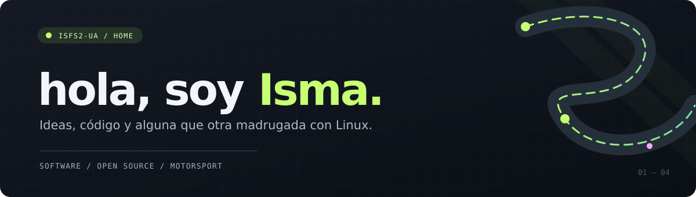
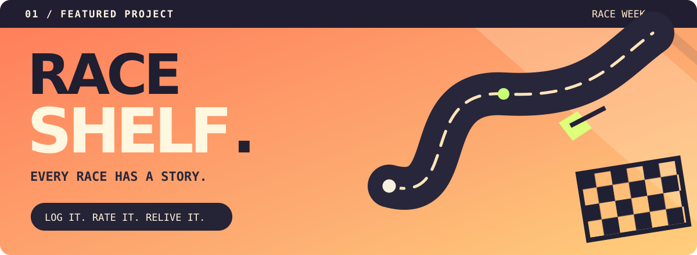
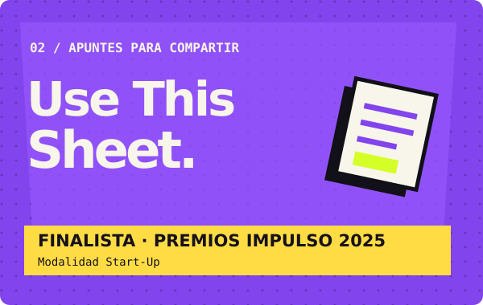
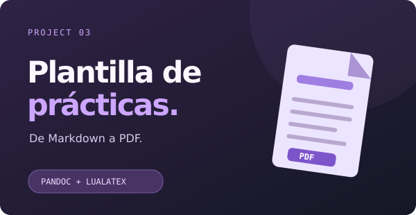

**Estudiante de Ingeniería Informática · Universidad de Alicante · Ingeniería del Software**

[**Mis repositorios**](https://github.com/isfs2-ua?tab=repositories) &nbsp;·&nbsp; [**RaceShelf**](https://raceshelf.com)

<table>
<tr>
<td width="61%" valign="top">
<h3>👋 Un poco sobre mí</h3>

Me gusta programar, cacharrear con Linux y meterme en proyectos que empiezan con un <em>«esto podría estar bien»</em> y acaban ocupándome bastante más tiempo del previsto.

Me interesa especialmente el desarrollo de software, pero también el software libre, los servidores propios y entender cómo funcionan las cosas por dentro. Este GitHub es, sobre todo, un sitio donde guardar lo que voy haciendo.

</td>
<td width="39%" valign="top">
<h3>✳️ Qué me interesa</h3>

⌨️ Desarrollo de software 🐧 Linux y software libre 🗄️ Servidores y self-hosting 🎮 Videojuegos y preservación digital 🏁 Motorsport

</td>
</tr>
</table>

## 🏁 Proyectos destacados

### [RaceShelf](https://raceshelf.com) · El Letterboxd del motorsport

Una plataforma para **registrar carreras vistas, puntuarlas, escribir reseñas, crear listas y descubrir otras**. Incluye calendario de eventos y funciones sociales para compartir la afición por disciplinas como F1, MotoGP, WEC y más. Es mi **Trabajo de Fin de Grado**, pero también un proyecto que quiero seguir desarrollando.

`Vue 3` · `TypeScript` · `Supabase` · `PostgreSQL` · `Tailwind CSS`

<table>
<tr>
<td width="50%" valign="top">

<h3><a href="https://isfs2-ua.github.io/landing-usethisheet/">Use This Sheet</a></h3>

Una plataforma para compartir apuntes universitarios y conectar estudiantes. La desarrollamos con Vue y Supabase. <strong>Finalista en la modalidad Start-Up de los Premios Impulso 2025</strong> del Parque Científico de Alicante.

</td>
<td width="50%" valign="top">

<h3><a href="https://github.com/isfs2-ua/Plantilla-Practicas-GII">Plantilla de prácticas</a></h3>

Una plantilla no oficial para escribir las memorias de Ingeniería Informática de la UA en <strong>Markdown</strong> y generar el PDF con Pandoc y LuaLaTeX. Incluye portadas y comprobaciones con GitHub Actions.

</td>
</tr>
</table>

## 🛠️ Tecnologías

## 📁 Más proyectos

También hay por aquí proyectos de clase, prácticas y alguna idea que se quedó a medias. Algunos ejemplos:

| Proyecto | De qué va | Tecnologías |
| :--- | :--- | :--- |
| **EVCharging Network** | Simulación de una red distribuida de cargadores eléctricos. | Python · Kafka · Docker · Sockets · REST |
| **TomoLog** | Colecciones de manga, reseñas y perfiles. | Vue · PocketBase · Azure |
| **SportHub** | Tienda online de artículos deportivos. | Java · Spring Boot · MySQL · Vue · Docker |
| **Unijobs** | Plataforma de empleo para universitarios. | PHP · Laravel |

[**Ver todos los repositorios →**](https://github.com/isfs2-ua?tab=repositories)

## 🐧 Linux, software libre y más

Uso Linux a diario y disfruto ajustando el escritorio, probando programas y montando servicios por mi cuenta. Me interesan el *self-hosting*, la preservación digital y las herramientas que permiten tener control sobre los propios datos. Siempre que puedo, prefiero utilizar y apoyar **software libre**.

---

No todo lo que hay aquí está terminado. Algunas ideas solo necesitaban un sitio donde existir.

